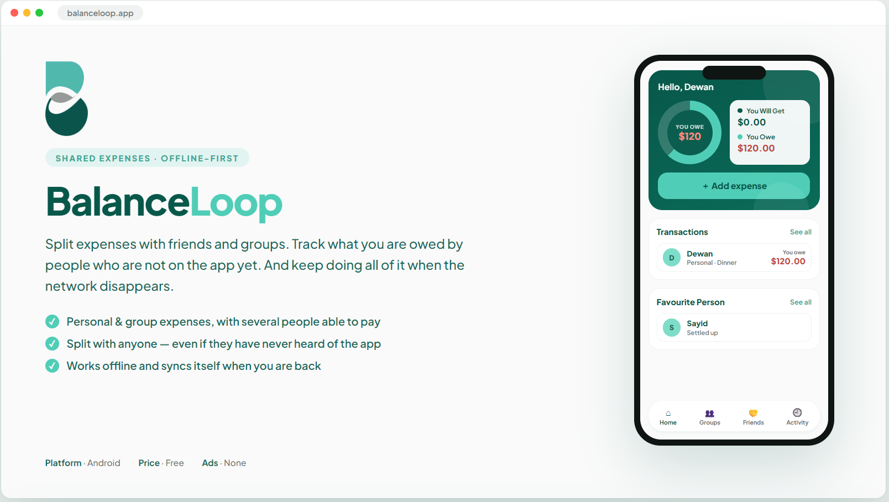
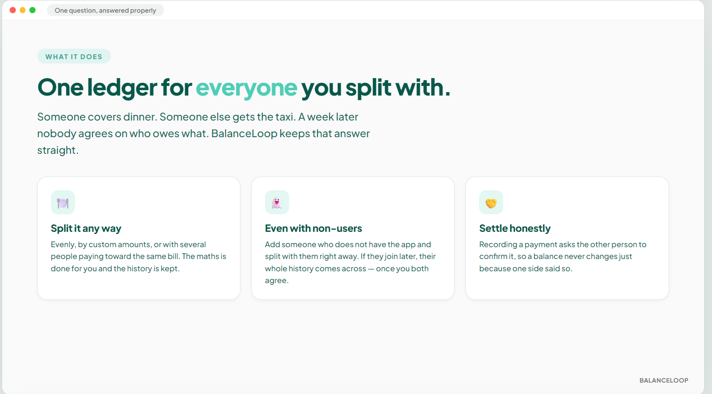
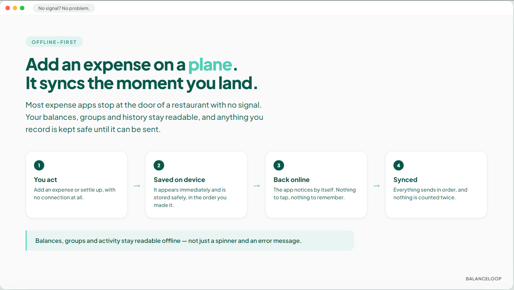
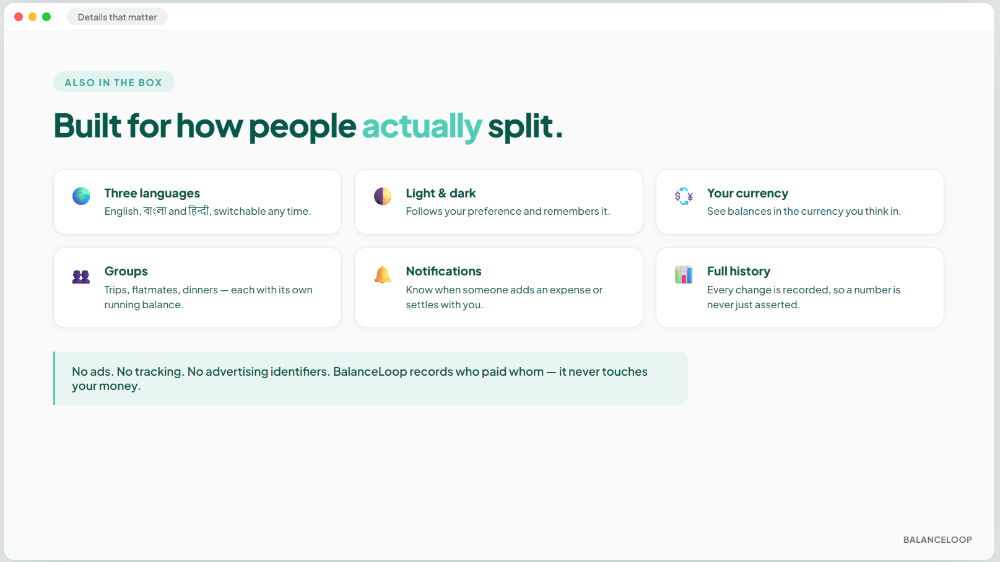
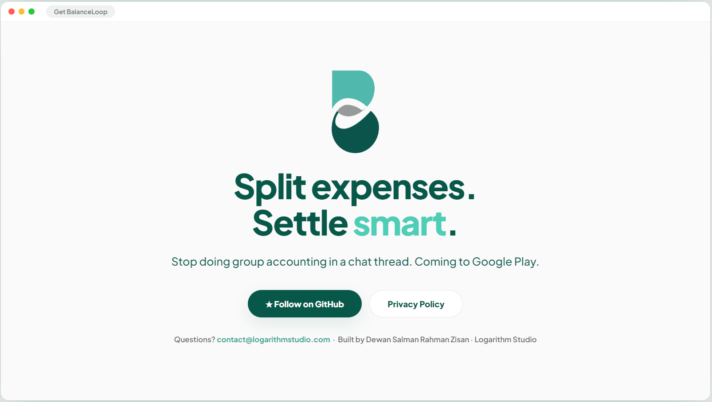

# BalanceLoop

### Split expenses. Settle smart. Stay in sync — even offline.

Track shared expenses, lending and balances between friends and groups —
and keep working when the network doesn't.

)

 

---

## The problem

Someone covers dinner. Someone else gets the taxi. A third person books the hotel.
A week later nobody agrees on who owes what, and the group chat turns into accounting.

BalanceLoop answers one question and keeps answering it: **who owes whom, and how much?**

## What it does

**Split any expense** — evenly, by custom amounts, or with several people paying toward
the same bill.

**Include people who don't have the app.** Add them as a contact and split with them
straight away. If they join BalanceLoop later, their entire history transfers across —
with both sides agreeing to it first.

**See every balance clearly**, per person and per group, with the full history behind
each number instead of a total you have to trust.

**Settle up honestly.** Recording a payment with another user asks them to confirm it, so
a balance never changes because one side said so.

> BalanceLoop records who paid whom. It does not move money and is not connected to any
> payment provider — you settle up however you already do.

## Works without a connection

Most expense apps stop at the door of a restaurant with no signal. This one doesn't.

- Balances, groups and history stay **readable offline**
- Expenses and settlements recorded offline are **saved on your device**
- They **send themselves** the moment you are back online, in the order you made them
- Nothing is double-counted if a sync is interrupted

## Also in the box

| | |
|---|---|
| 🌍 **Three languages** | English, বাংলা, हिन्दी |
| 🌓 **Light & dark** | Follows your preference, remembered between sessions |
| 💱 **Multiple currencies** | Display your balances in the currency you think in |
| 👥 **Groups** | Trips, flatmates, dinners — each with its own running balance |
| 🔔 **Notifications** | Know when someone adds an expense or settles with you |
| 📊 **Full history** | Every change to a balance is recorded and reviewable |

## Privacy

No ads. No tracking. No advertising identifiers. Your expenses are visible to the people
you split with — that is how splitting works — and to nobody else.

Read the full [Privacy Policy](privacy-policy.html).

## Download

Download it from Google Play Store.

## About this repository

This is the **public home** for BalanceLoop — its documentation, privacy policy and
release information.

Built with React Native and Expo, on a PostgreSQL backend.

## Contact

Questions, bug reports or press: **contact@logarithmstudio.com**

---

Built by **Dewan Salman Rahman Zisan**

under **Logarithm Studio**

MIT licensed — see <a href="LICENSE">LICENSE</a>

